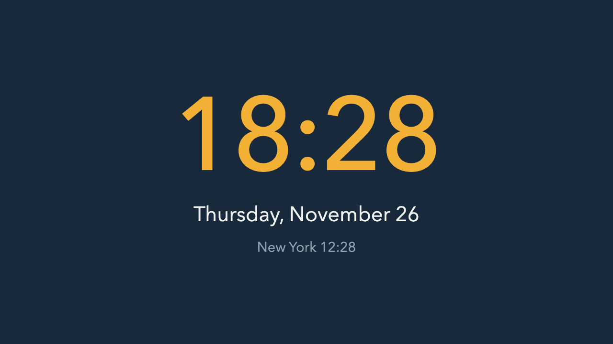
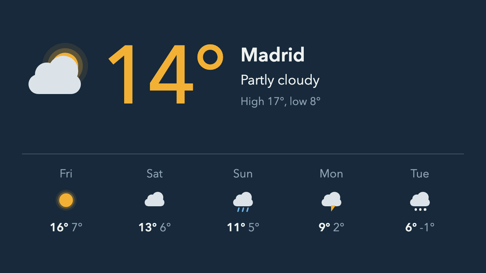
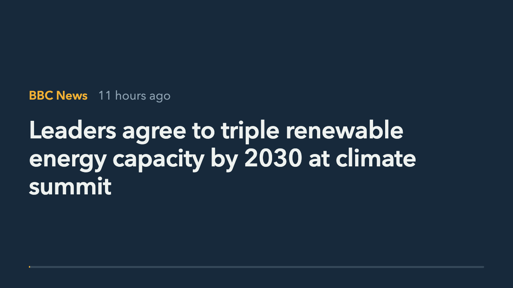
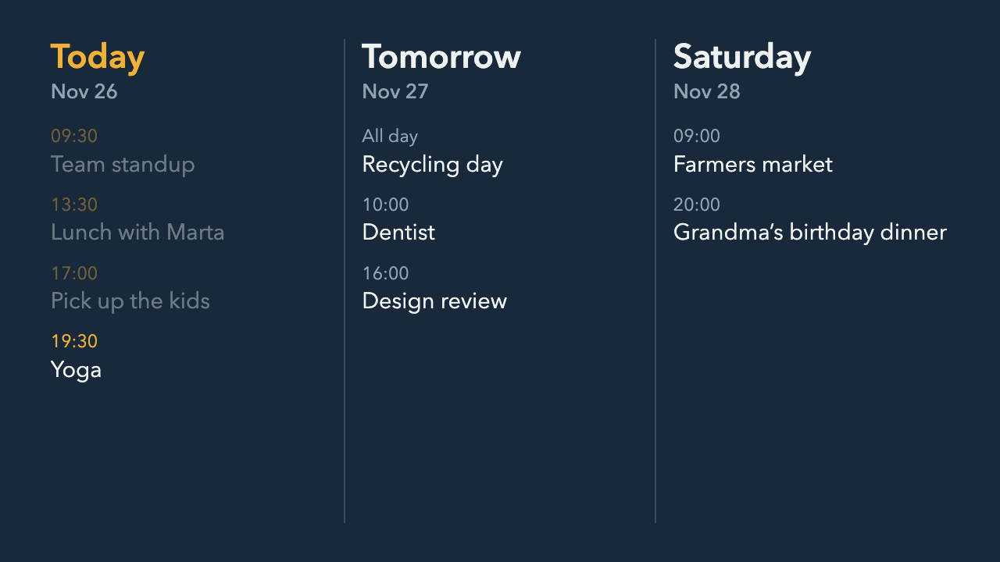
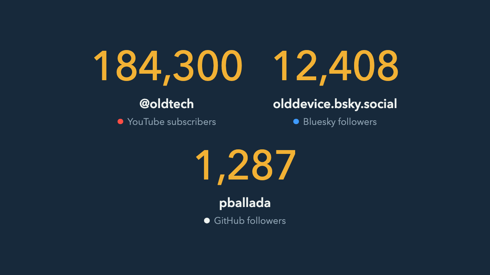

# olddevice modes

[olddevice](https://github.com/pballada/olddevice) turns old iPads, phones, tablets and TVs into always-on displays. Each thing a screen can show (a clock, a photo frame, weather…) is a **mode**, and every mode lives in this repo.

Want a screen to show something new? Add a mode with a pull request.

## Modes

### Clock

A big wall clock, with an optional second time zone.



### Weather

Current weather and a five-day forecast for one place, from Open-Meteo.



### Photos

A photo frame for a shared album on iCloud, Dropbox or Google Drive. Your photos stay where they are.


### News

Headlines from news sites and blogs, one at a time, with their source and time.



### Calendar

What's on today and the next few days, from a public or secret calendar link (.ics).



### Follower counters

Live follower and subscriber counts for YouTube, Bluesky, Mastodon and GitHub accounts.



Screenshots are taken from the preview at 1280×720: `npm run preview`, then open `http://localhost:5173/tools/preview/?mode=<id>&bare`.

## Try it

```sh
npm ci
npm run preview     # open http://localhost:5173/tools/preview/
npm test
npm run check       # what CI runs on every pull request
```

The preview shows any mode with its example settings. Edit the settings in the box and the screen updates.

## What's in a mode

```
modes/clock/
  mode.json            name, description, settings, data source, example settings
  screen.js            draws the mode (ES5 — it runs on iPads from 2011)
  screen.css           optional styles, classes start with m-clock-
  example-data.json    only for modes that use a data source
```

See [CONTRIBUTING.md](CONTRIBUTING.md) for the rules and how to submit one.

## How modes reach screens

The olddevice app pins a version of this repo. After a pull request is merged here, the maintainer updates that pin and deploys, and the new mode appears in everyone's dashboard.

## License

MIT. By contributing, you agree your contribution is released under the same license.
